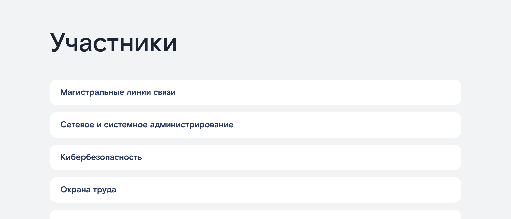

# Корпоративный чемпионат «Ростелекома» по стандартам WorldSkills

Лендинг VII Корпоративного чемпионата профессионального мастерства «Ростелекома» по пяти компетенциям (5–8 сентября 2022, учебно-производственный центр в Бекасово).


| Компетенции участников | Мобильная версия |
|---|---|
|  |  |

## Содержание страницы

- приветственный блок с датами и хэштегами мероприятия
- видеообращение и слово руководства
- место проведения и фотогалерея прошлых чемпионатов
- таймлайн программы чемпионата
- компетенции участников в аккордеоне: магистральные линии связи, сетевое и системное администрирование, кибербезопасность, охрана труда, машинное обучение и большие данные
- карточки главных экспертов и организаторов

## Технологии

Страница собрана в [Tilda](https://tilda.cc) (Zero Block) и экспортирована в статический HTML: шрифт Rostelecom Basis, анимации Tilda, адаптивная вёрстка под десктоп и мобильные устройства. Сборка не нужна.

Стили, скрипты и шрифты лежат в репозитории. Фотографии и иллюстрации Tilda подгружает со своего CDN (`static.tildacdn.com`), а в `images/` лежат только превью для lazy-load, поэтому для полной картинки нужен интернет.

## Запуск

Откройте `index.html` в браузере или поднимите локальный сервер:

```bash
python3 -m http.server 8000
```

Чтобы опубликовать страницу на GitHub Pages, откройте Settings → Pages, выберите Source: *Deploy from a branch* и ветку `main` / `root`.

## Структура

```
index.html   страница
css/         стили Tilda (grid, анимации, блоки страницы)
js/          скрипты Tilda и jQuery
images/      изображения
fonts/       фирменный шрифт и SVG-иконки
docs/        скриншоты для README
```
