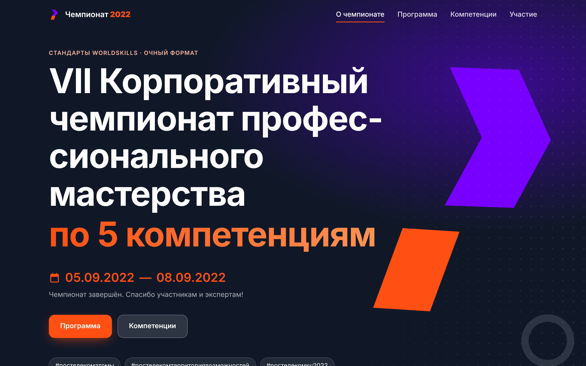
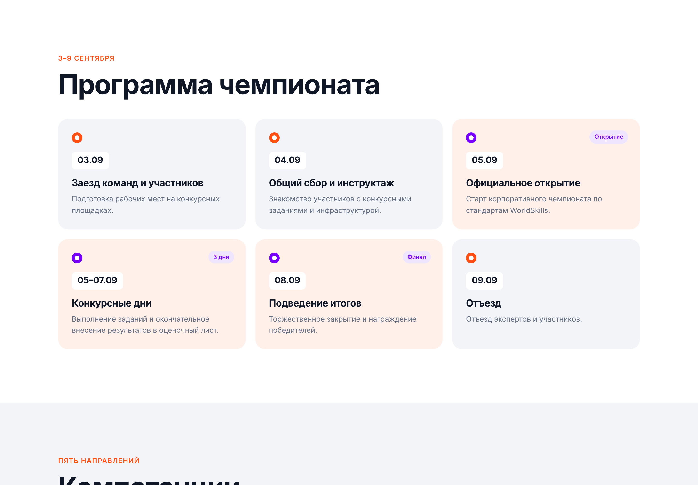
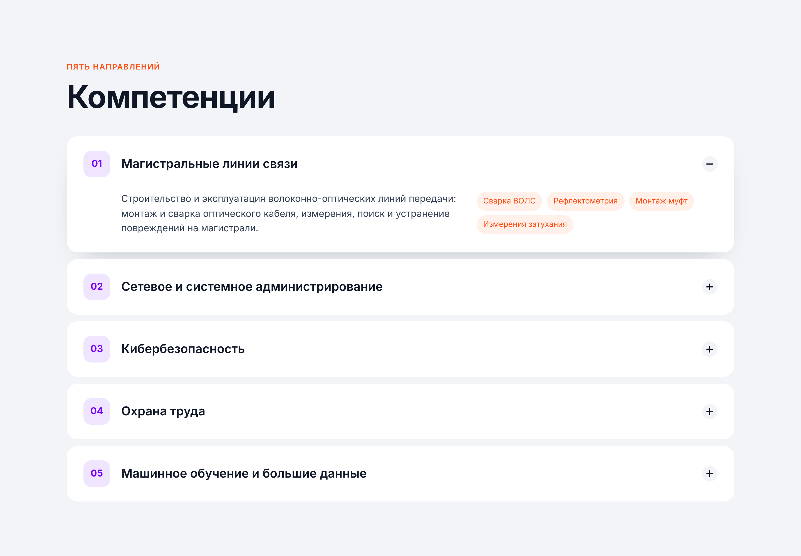
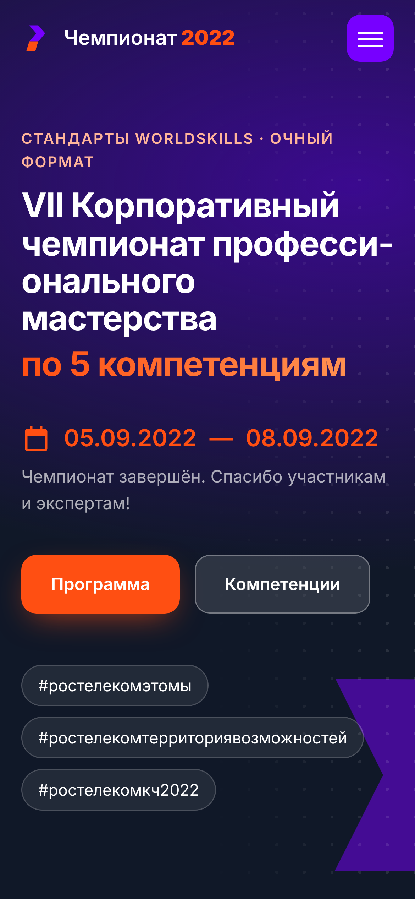
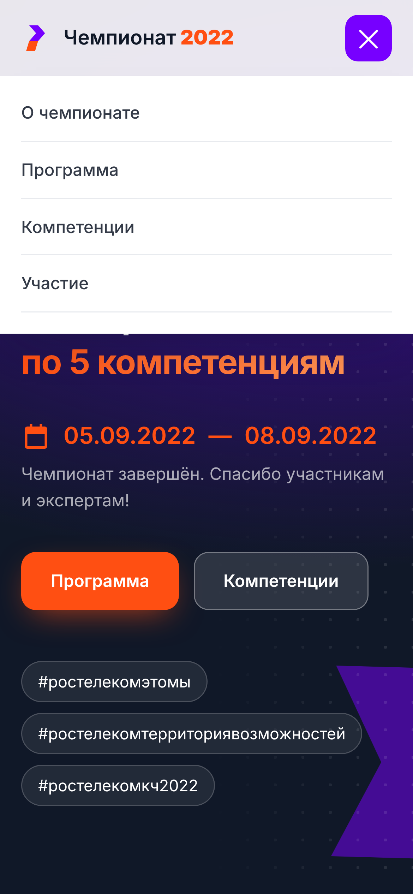

# Лендинг корпоративного чемпионата профмастерства

Одностраничный сайт VII Корпоративного чемпионата профессионального мастерства по стандартам WorldSkills: программа, пять компетенций и формат участия. Написан вручную на HTML, CSS и JavaScript без конструкторов, фреймворков и сборки. Изначально страница была собрана в Tilda, эта версия переписана с нуля.



## Что внутри

- **Первый экран**: анимированные геометрические фигуры, даты и статус чемпионата («до старта N дней», «идёт сейчас» или «завершён»), который вычисляется по текущей дате
- **Счётчики** с анимацией при появлении в зоне видимости
- **Таймлайн программы**: ключевые события выделены бейджами
- **Аккордеон компетенций**: описание направления и набор проверяемых навыков
- **Роли** участника, компатриота и эксперта
- **Шапка** становится плотной при прокрутке, текущий раздел подсвечивается в меню, на мобильных есть бургер-меню
- **Доступность**: семантическая разметка, `aria-expanded` у аккордеона и меню, поддержка `prefers-reduced-motion`

| Программа | Компетенции |
|---|---|
|  |  |

| Мобильная версия | Меню |
|---|---|
|  |  |

## Технологии

- HTML5, семантические секции
- CSS: Grid и Flexbox, `clamp()` для типографики, CSS-переменные, анимации на `clip-path` и `@keyframes`, плавное раскрытие аккордеона через `grid-template-rows`
- Vanilla JS: контент программы и компетенций хранится в массивах, `IntersectionObserver` для появления блоков, счётчиков и подсветки меню

Внешних зависимостей и загрузок с CDN нет: страница целиком работает офлайн.

## Запуск

Откройте `index.html` в браузере или поднимите локальный сервер:

```bash
python3 -m http.server 8000
```

GitHub Pages: Settings → Pages → Deploy from a branch → `main` / `root`.

## Структура

```
index.html    разметка
styles.css    стили и адаптив
app.js        данные программы и компетенций, интерактив
favicon.svg   иконка
docs/         скриншоты
```
